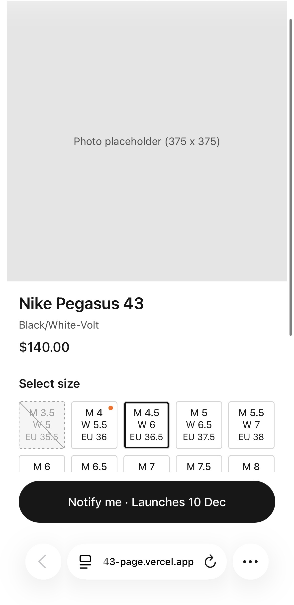

Live page: https://pegasus-43-page.vercel.app

# Nike Pegasus 43 phone product page

Planning notes for a phone-first product page for the Nike Pegasus 43 (Black/White-Volt), built from a size and stock list of 26 sizes.

**Live page:** https://pegasus-43-page.vercel.app

The page code (Next.js) is in the [`pegasus-page`](pegasus-page) folder.

The page is planned at **375 px wide**, with a first screen of 375 x 667 px. Every size button is at least 44 x 44 px, and sold-out sizes stay greyed out in their own place.

## On my phone



The live page on my phone, with M 4.5 / W 6 / EU 36.5 selected.

## Section order

1. Photos
2. Name and price (Nike Pegasus 43, Black/White-Volt, $140.00, shown once)
3. Sizes (26 buttons, with a sticky Add to bag / Notify me button underneath)
4. Tech copy
5. Reviews

## Decisions

- **Size grid:** Option 1. 5 buttons per row, 62 x 64 px, each showing men's US, women's US and EU sizes. 16 + (5 x 62) + (4 x 8) + 16 = 374 px.
- **Main button:** sticky at the bottom of the screen, so it shows on the first screen.
- **Launch date:** shown on the button, "Notify me · Launches 10 Dec", until 10 December 2026.

## Files

| File | What it is |
|---|---|
| [`pegasus-page/`](pegasus-page/) | The Next.js page code |
| [`speed-budget.json`](speed-budget.json) | The speed budget the mobile launch check reads (90, 0, 44) |
| [`notes/trace-findings.md`](notes/trace-findings.md) | Findings from the Slow 4G phone trace of the live page: layout shifts, size grid position, LCP, test IDs, and fixes |
| [`notes/trace-prompt.md`](notes/trace-prompt.md) | The prompt used to record the trace |
| [`notes/speed-budget-notes.md`](notes/speed-budget-notes.md) | What the three values in `speed-budget.json` mean, and how they match Diego's profile |
| [`traces/slow-4g-live.json`](traces/slow-4g-live.json) | The raw Chrome performance trace before the fixes (Slow 4G, 4x CPU, 375 x 812 at 3x) |
| [`traces/slow-4g-live-after-fixes.json`](traces/slow-4g-live-after-fixes.json) | The raw Chrome performance trace after the fixes, with the same settings |
| [`lighthouse/`](lighthouse/) | Mobile Lighthouse setup and reports for the live page: `config.js` (Diego's settings) and `run-1` to `run-3` as JSON and HTML |
| [`notes/lighthouse-results.md`](notes/lighthouse-results.md) | The Lighthouse results: the 3 scores and median, pass or fail for each speed budget key, metrics and top suggestions |
| [`notes/page-plan-final.md`](notes/page-plan-final.md) | The final plan document: the page plan, the final prompt, what I checked, and my decisions |
| [`notes/PAGE_PLAN.md`](notes/PAGE_PLAN.md) | The page plan Claude Code wrote from `prompt.md` |
| [`notes/prompt.md`](notes/prompt.md) | The prompt that produced the plan, with the fixed requirements |
| [`notes/order.md`](notes/order.md) | The section order |
| [`notes/build.md`](notes/build.md) | The prompt for building the page in Next.js |
| [`notes/push.md`](notes/push.md) | The prompt for putting the built page on GitHub |
| [`notes/nike_pegasus_size_stock_….json`](notes/nike_pegasus_size_stock_b2ebb9fac7f74d6a8bb3432d7642176f.json) | The Pegasus 43 size and stock list |
| [`screenshots/phone-size-selected.png`](screenshots/phone-size-selected.png) | Screenshot of the live page on my phone with a size selected |
| [`notes/`](notes) | All the notes: the plan, prompts, trace findings, speed budget notes and Lighthouse results |
| [`traces/`](traces) | The raw Chrome performance traces |

The Google Doc version of the plan: https://docs.google.com/document/d/1SteBFWYTyxsNt_9q5JAWZO4FAHlm-3FFer97I9C3E9U/edit?usp=sharing

## Run it

```sh
cd pegasus-page
npm install
npm run dev
```

Open http://localhost:3000, then use the browser's device toolbar (F12, then Ctrl+Shift+M) and set the size to 375 x 812.
